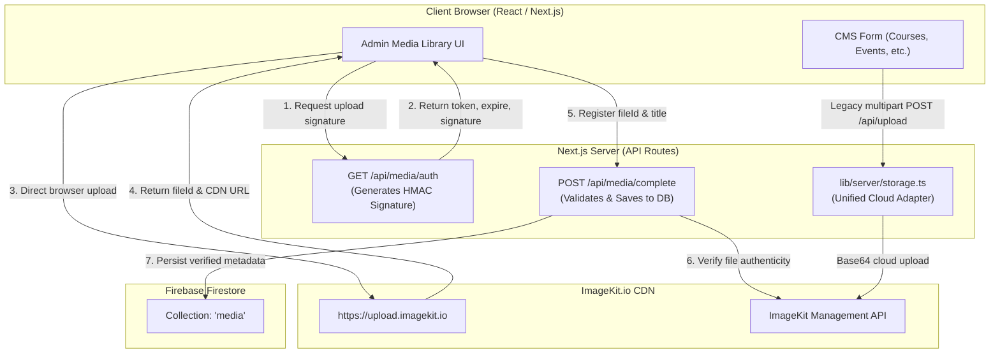

# Race Support CMS — Media Storage & ImageKit Integration Guide

A comprehensive technical and operational guide for the Media Storage architecture, ImageKit cloud delivery, Firebase Firestore metadata tracking, and serverless deployment safety.

---

## 1. System Overview & Architecture

The media subsystem provides two complementary workflows:
1. **Direct-to-Cloud Admin Uploads (Media Library)**: The frontend uploads large assets (images & videos) directly to ImageKit using short-lived cryptographically signed tokens from the backend. The server never bears high-bandwidth payload loads.
2. **Unified Server Storage Adapter (`lib/server/storage.ts`)**: Existing CMS endpoints (Courses, Events, Projects, Changemakers, Team, Gallery) automatically delegate image uploads to ImageKit cloud, eliminating local read-only filesystem errors (`EROFS`) in serverless environments like Vercel.



---

## 2. Environment Variables Configuration

The media tool requires credentials in your `.env` (or Vercel Environment Variables):

| Variable Name | Exposure | Purpose | Example / Format |
|---|---|---|---|
| `IMAGEKIT_PUBLIC_KEY` | Server-only | Public identifier for ImageKit account | `public_P8gD1bHZpTqLI+...` |
| `IMAGEKIT_PRIVATE_KEY` | **Server-only (Secret)** | Signs auth tokens & manages asset deletion | `private_lhZQ54c3JVF...` |
| `IMAGEKIT_URL_ENDPOINT` | Server-only | Base CDN endpoint for transformed delivery | `https://ik.imagekit.io/your_id` |
| `NEXT_PUBLIC_IMAGEKIT_PUBLIC_KEY` | Client & Server | Used by browser SDK for client uploads | `public_P8gD1bHZpTqLI+...` |
| `NEXT_PUBLIC_IMAGEKIT_URL_ENDPOINT` | Client & Server | Used by browser components to construct URLs | `https://ik.imagekit.io/your_id` |

> [!CAUTION]
> Never prefix `IMAGEKIT_PRIVATE_KEY` with `NEXT_PUBLIC_`. The private key must remain strictly on the backend to prevent unauthorized uploads or deletions.

---

## 3. Storage Hierarchy & Fallback Logic

When files are uploaded via standard CMS modules (e.g. adding course banners or event posters), [lib/server/storage.ts](file:///c:/Users/Althaf-Cordova/Desktop/Company/new/RaceSupportTest2/lib/server/storage.ts) executes the following multi-tiered strategy:

```
[Incoming File]
       │
       ▼
1. Is IMAGEKIT_PRIVATE_KEY configured?
   ├── YES ──► Upload to ImageKit (`/{folder}`) ──► [SUCCESS]
   └── NO / FAILS
         │
         ▼
2. Is Firebase Storage bucket available?
   ├── YES ──► Upload to Firebase Storage ──► [SUCCESS]
   └── NO / FAILS
         │
         ▼
3. Is environment local development?
   ├── YES (Local Node) ──► Write to `./public/uploads/{folder}`
   └── NO (Vercel / AWS Lambda) ──► Throw descriptive error (prevents EROFS crash)
```

### Why this solves `EROFS`
In Vercel and serverless runtimes, the local disk (`/var/task`) is strictly read-only. Tier 1 guarantees that assets are uploaded to ImageKit cloud, preventing any attempt to write to local disk.

---

## 4. Validation Rules & Constraints

Both the client UI and the backend enforce strict validation rules:

| Media Category | Allowed MIME Types | File Extensions | Max Allowed Size |
|---|---|---|---|
| **Images** | `image/jpeg`, `image/png`, `image/webp`, `image/gif` | `.jpg`, `.jpeg`, `.png`, `.webp`, `.gif` | **25 MB** |
| **Videos** | `video/mp4`, `video/webm` | `.mp4`, `.webm` | **100 MB** |

### Additional Security Checks:
- **Zero-byte check**: Files with `0` bytes are immediately rejected.
- **Folder Isolation**: Media library uploads are constrained to the `/admin-media` namespace.
- **MIME Tamper Prevention**: The backend inspects the actual metadata returned by ImageKit's API rather than trusting the browser-sent header.

---

## 5. Firestore Data Model (`media` collection)

Every verified upload creates a record in Firestore under collection **`media`**:

```json
{
  "id": "e6f47721-7fbd-498b-ba52-0f04c64b5849",
  "title": "Annual Leadership Summit Recap",
  "fileId": "6ae07aa9ead997d09a780324",
  "url": "https://ik.imagekit.io/pn2q2scgc/admin-media/summit.mp4",
  "fileName": "summit.mp4",
  "mediaType": "video",
  "mimeType": "video/mp4",
  "size": 52428800,
  "folder": "/admin-media",
  "uploadedBy": "firebase_admin_uid_here",
  "uploadedByEmail": "admin@raceindia.org",
  "createdAt": "2026-10-27T15:40:00.000Z",
  "updatedAt": "2026-10-27T15:40:00.000Z"
}
```

- Timestamps use native Firestore `FieldValue.serverTimestamp()`.
- Idempotency is enforced: if an upload succeeds on ImageKit but the persistence call is retried, existing records with matching `fileId` are returned rather than duplicated.

---

## 6. API Reference

All routes are authenticated and require `role === "admin"`. Unauthenticated requests receive **`401`**, and non-admin users receive **`403`**.

### 1. `GET /api/media/auth`
Generates short-lived HMAC-SHA1 upload signatures for ImageKit.
- **Headers**: `Cache-Control: no-store`
- **Response**:
  ```json
  {
    "success": true,
    "data": {
      "token": "83d0ae85-f4cc-4cee-9c19-966412df6080",
      "expire": 1793097991,
      "signature": "64b5070280bd774aa788893d8a965897c09fe55f",
      "publicKey": "public_...",
      "urlEndpoint": "https://ik.imagekit.io/..."
    }
  }
  ```

### 2. `POST /api/media/complete`
Validates an uploaded asset against ImageKit and creates the Firestore document.
- **Body**: `{ "fileId": "6ae07...", "title": "Optional Title" }`
- **Status**: `201 Created`

### 3. `GET /api/media`
Retrieves paginated media records ordered by creation date descending.
- **Query Params**:
  - `page`: Page index (default: `1`)
  - `limit`: Items per page (default: `20`, max `100`)
  - `mediaType`: Optional filter (`image` or `video`)

### 4. `PATCH /api/media/:id`
Updates editable fields (e.g., `title`).
- **Body**: `{ "title": "Updated Title" }`

### 5. `DELETE /api/media/:id`
Deletes the file from ImageKit via API, then deletes the Firestore document.

---

## 7. Admin UI Guide (`/dashboard/media`)

Navigate to **Media Library** in the dashboard sidebar:

1. **Upload Tab**:
   - Drag & drop or select an image or video.
   - Enter an optional title (defaults to the clean filename).
   - Click **Upload Media** — a progress bar tracks upload percentages directly to ImageKit.
2. **Gallery & Player**:
   - Images display optimized thumbnails; clicking opens the full lightbox.
   - Videos have native embedded controls (`<video controls>`) with zero transcoding delay.
3. **Card Actions**:
   - **Copy Link**: Copies the high-speed CDN URL to your clipboard.
   - **Open**: Opens the original file in a new tab.
   - **Edit Title**: Rename the title in Firestore.
   - **Delete**: Triggers a safety dialog and removes both cloud file and database entry.
